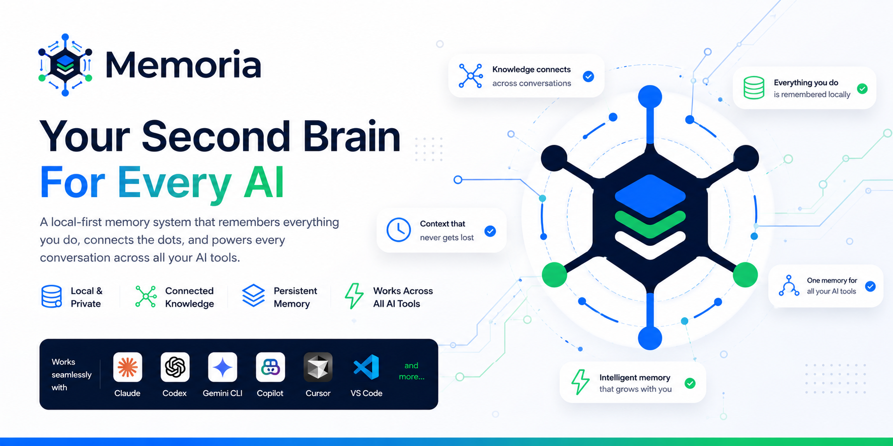
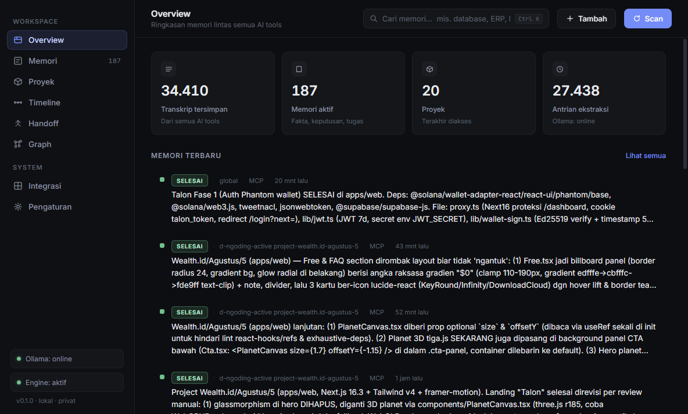
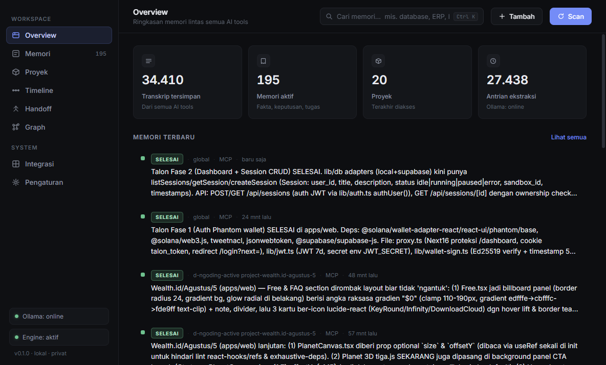
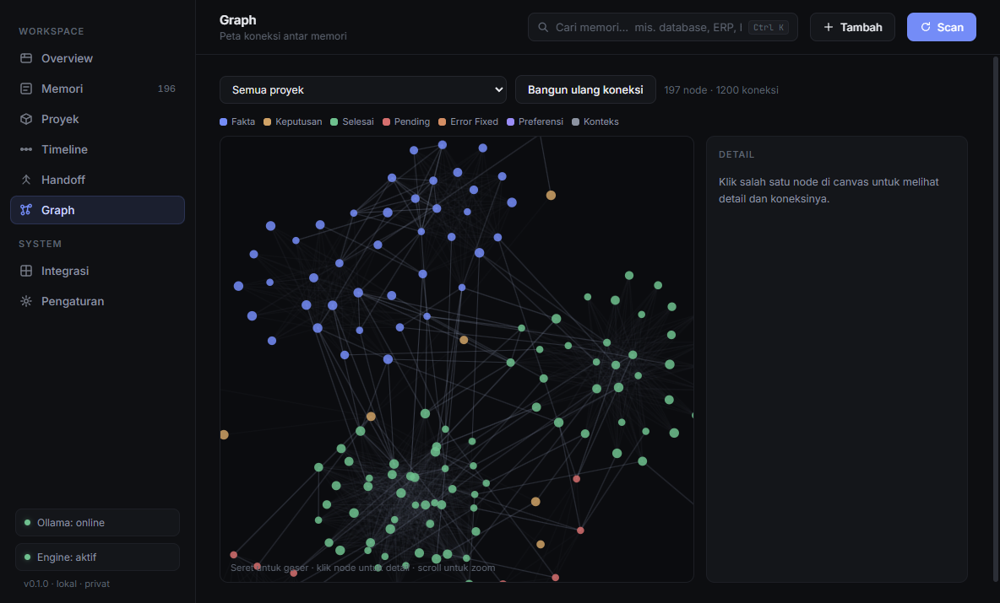
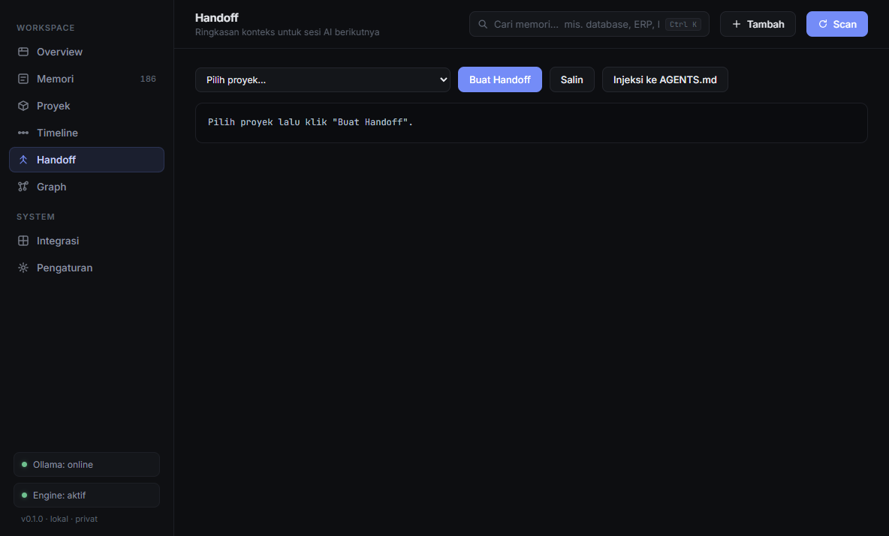
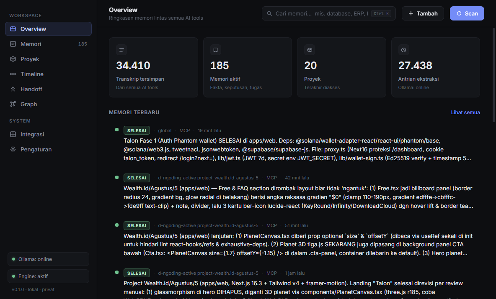

<div align="center">



# Memoria

**Second brain offline untuk semua AI coding tools.**

Claude Code, Codex, Gemini CLI, Copilot, Antigravity, sampai opencode — satu otak bersama yang mengingat semua yang pernah Anda kerjakan, dan menyalurkannya ke sesi berikutnya. Tanpa internet, tanpa cloud, tidak ada satu baris pun yang keluar dari komputer Anda.

<br>


[](https://github.com/xinzzu/Memoria/releases)
[](https://github.com/xinzzu/Memoria/actions)
[](LICENSE)

</div>

---

<details>
<summary>Daftar isi</summary>

- [Kenapa dibutuhkan?](#kenapa-dibutuhkan)
- [Cara kerjanya](#cara-kerjanya)
- [Fitur utama](#fitur-utama)
- [Kebutuhan](#kebutuhan)
- [Quickstart](#quickstart)
- [Dashboard](#dashboard)
- [Pengembangan](#pengembangan)
- [Roadmap](#roadmap)
- [FAQ](#faq)
- [Lisensi](#lisensi)

</details>

---

## Kenapa dibutuhkan?

Setiap tool AI Anda punya **memori pendek**. Claude tidak ingat pekerjaan di sesi kemarin. Copilot tidak tahu keputusan "pakai grid 12 kolom" yang sudah disepakati di Gemini CLI. Akibatnya: Anda menjelaskan ulang, AI belajar ulang, dan waktu terbuang.

Memoria menutup celah itu — dan melakukannya **100% lokal**.

---

## Cara kerjanya

```
              Sesi AI tools Anda
   Claude Code · Codex · Gemini · Copilot · Antigravity · opencode
        │                            │
        │  jsonl / sqlite / logs     │  perintah /memory, /recall
        ▼                            ▼
    WATCHER (real-time)            MCP SERVER (stdio)
        │                            ▲
        ▼                            │
   EXTRACTOR (Ollama, lokal)         │
   meringkas sesi → fakta,           │
   keputusan, tugas, error-fix       │
        ▼                            │
   ┌──────────────────────────────┐ │
   │   LOCAL DATABASE (SQLite)    │──── konteks proyek
   │   memori + graf koneksi      │   tersuntik ke AGENTS.md
   │   + embedding vector         │
   └──────────────┬───────────────┘
                  ▼
        DASHBOARD desktop (Electron)
        timeline, graph memori, handoff
```

**Alur sederhananya:**

1. Bekerja seperti biasa di tool AI favorit Anda.
2. Memoria menangkap sesi baru (watcher real-time) dan menyimpannya lokal.
3. Model lokal Ollama mengekstrak `fakta`, `keputusan`, `tugas`, dan `error-fix`, lalu merekamnya sebagai memori terindeks (keyword + embedding + graph).
4. Saat Anda membuka sesi baru di **tool mana pun**, konteks proyek yang relevan otomatis tersuntik ke `AGENTS.md` — agent langsung "ingat" dari sesi sebelumnya.
5. Buka dashboard kapan saja: telusuri timeline, peta memori, atau buat handoff untuk sesi berikutnya.

---

## Fitur utama

| Fitur | Deskripsi |
|-------|-----------|
| Capture multi-tool | Membaca transkrip dari 9 tool AI: Claude Code, Codex, Gemini CLI, Copilot, Antigravity, opencode, **VS Code, Cursor, Windsurf** |
| Ekstraksi lokal | Ollama `qwen2.5-coder:3b` meringkas sesi menjadi memori terstruktur: fakta, keputusan, tugas, error fix |
| Ingat di semua tool | MCP server (stdio) universal — daftarkan sekali, Memoria jadi memori semua tool Anda |
| Auto-konteks | Handoff ringkas otomatis diinjeksi ke `AGENTS.md` proyek aktif sebelum sesi baru dimulai |
| Retrieval hibrid | Keyword + embedding (`nomic-embed-text`) + popularitas graph (centrality), dengan **toleransi typo (fuzzy)** |
| Peta memori | Graf koneksi antar memori: kesamaan topik, kata kunci, dan "memori seangkatan" (cohort) |
| Timeline & Handoff | Jejak aktivitas per proyek + ringkasan konteks siap salin/injeksi |
| Siklus tugas | Tugas `Pending` terdeteksi selesai otomatis saat jejaknya muncul di transkrip berikutnya |
| Mode tinjau (draft) | Memori baru mengantre di tab "Menunggu persetujuan" sampai Anda approve |
| Cadangan & restore | Backup berkala otomatis + pulihkan satu-klik dari dashboard |
| Cari memori global | Palet pencarian `Ctrl+Shift+Space` — cari & salin memori dari mana saja |
| Catat cepat | Shortcut global `Ctrl+Shift+M` untuk menyimpan ide dari mana saja |
| Entitas & topik otomatis | Chips entitas (URL, path, command, teknologi) + clustering embedding jadi tag topik |
| Ekspor Obsidian | Vault Markdown siap pakai dengan frontmatter, `[[wikilinks]]`, dan Index |
| Tanpa cloud | Semua data di `~/.memoria` — Anda pemilik penuh |

---

## Kebutuhan

| | Minimal |
|---|---|
| Windows | Windows 10/11 |
| Linux | distro berbasis .deb (Ubuntu/Debian) atau AppImage; tray icon butuh libappindicator |
| macOS | macOS 12+ (Apple Silicon maupun Intel) |
| Node.js | ≥ 22.5 (dibutuhkan saat build dari source) |
| Ollama | `qwen2.5-coder:3b` + `nomic-embed-text` |
| RAM | 4 GB (rekomendasi 8 GB) |
| GPU | Opsional — tanpa GPU pun berjalan (CPU-only) |

---

## Quickstart

### 1. Install

| OS | Paket |
|---|---|
| Windows | Unduh `Memoria Setup 0.1.0.exe` dari [Releases](https://github.com/xinzzu/Memoria/releases) |
| Linux | `memoria_0.1.0_amd64.deb` (`sudo dpkg -i`) atau `Memoria-0.1.0.AppImage` (`chmod +x` lalu jalankan) |
| macOS | `Memoria-0.1.0.dmg` (drag ke Applications; bila tertahan, kanan-klik → Open) |

Aplikasi hidup sebagai **tray icon**, scan pertama berjalan otomatis.

### 2. Siapkan Ollama (sekali saja)

```bash
ollama pull qwen2.5-coder:3b
ollama pull nomic-embed-text
```

Memoria otomatis meluncurkan Ollama saat start bila belum menyala.

### 3. Daftarkan ke tool AI Anda

Buka tab **Integrasi** di dashboard, klik **Daftarkan** untuk masing-masing tool:

| Tool | Konfigurasi |
|------|-------------|
| Claude Code | MCP di `~/.claude.json` + command `/memory` |
| Codex CLI | `~/.codex/config.toml` |
| opencode | `~/.config/opencode/opencode.json` |
| Gemini CLI | `~/.gemini/settings.json` |
| Copilot | `~/.copilot/mcp-config.json` |
| Antigravity | `~/.gemini/config/mcp_config.json` |
| VS Code / Cursor / Windsurf | Baca otomatis dari `state.vscdb` — aktifkan toggle di Pengaturan |

Mulai sesi baru, lalu beri tahu agent:

```
Ingat keputusan proyek ini dari sesi sebelumnya.
```

### 4. CLI

```bash
node dist/engine/index.js scan                   # scan semua tool sekarang juga
node dist/engine/index.js recall "docker issue"  # cari memori
node dist/engine/index.js status                 # status memori + Ollama
```

Mode MCP (stdio): `node dist/engine/index.js mcp`

---

## Dashboard

Aplikasi desktop (Electron, tray), seluruh tampilan berbahasa Indonesia.

- **Overview** — statistik memori, memori terbaru, proyek aktif.
- **Memori** — pencarian lintas tool, filter jenis & proyek, tab *Menunggu persetujuan* (draft) dan *Arsip*.
- **Proyek** — aktivitas berdasarkan proyek.
- **Timeline** — jejak aktivitas per proyek + riwayat git.
- **Handoff** — generate, salin, atau injeksi ringkasan konteks ke `AGENTS.md`.
- **Graph** — peta visual antar memori; klik node untuk detail koneksi & backlink.
- **Integrasi** — daftarkan MCP server ke semua tool sekali klik.
- **Pengaturan** — sumber data, model, perilaku otomatis (Ollama, backup harian, arsip usang, mode tinjau, auto-inject), plus daftar cadangan & restore.

<details>
<summary>Lihat tampilan</summary>

**Overview**



**Memori + tab draft/arsip**



**Peta koneksi memori**



**Handoff**



**Pengaturan**



</details>

---

## Pengembangan

### Build dari source

```bash
git clone <url-repo> && cd memoria
npm install
npm run dev         # TypeScript watch mode
npm run build       # kompilasi sekali
npm run start       # jalankan Electron dev (server di port 48210)
npm run dist        # Windows → dist-installer/Memoria Setup 0.1.0.exe
npm run dist:linux  # Linux → AppImage + .deb (disarankan dari runner Linux)
npm run dist:mac    # macOS → .dmg + .zip (wajib dari mesin macOS)
```

> Catatan: instalernya menghasilkan artefak per platform. AppImage & .deb juga bisa diproduksi otomatis oleh GitHub Actions (`Build Installers` workflow di `.github/workflows/build.yml`).

### Struktur proyek

```
src/
├── engine/
│   ├── config.ts         # konfigurasi sumber data & tool (per-OS)
│   ├── http.ts           # API HTTP lokal (port 48210)
│   ├── ingest/           # watcher sesi + parser per tool (claude, codex, vscdb, …)
│   │   ├── manager.ts    # orkestrasi scan & pipeline memori
│   │   └── vscdb.ts      # baca state.vscdb (VS Code/Cursor/Windsurf)
│   ├── extract/
│   │   ├── extractor.ts  # ekstraksi LLM (Ollama) + antrian
│   │   ├── entities.ts   # deteksi entitas (URL, path, perintah)
│   │   ├── topics.ts     # clustering embedding → tag topik
│   │   ├── tasklife.ts   # deteksi penyelesaian tugas Pending
│   │   └── dedupe.ts     # deduplikasi & merge memori
│   ├── retrieve/search.ts # retrieval hibrid + re-ranking
│   ├── vecfind.ts        # index LSH untuk skala embedding besar
│   ├── graph.ts          # graf memori (similarity/keyword/cohort)
│   ├── handoff.ts        # handoff + auto-inject konteks
│   ├── summary/weekly.ts # ringkasan mingguan otomatis
│   ├── export/obsidian.ts # ekspor vault Obsidian
│   ├── mcp/server.ts     # MCP server (stdio)
│   ├── store/            # SQLite (node:sqlite), backup & restore
│   ├── lifecycle.ts      # agenda background (backup, arsip, topik, digest)
│   └── index.ts          # entry: CLI (scan/recall/status), server, MCP
├── electron/main.ts      # tray, dashboard, hotkey global
web/                      # dashboard UI (HTML/JS murni)
scripts/gen-icon.js       # generator ikon
.github/workflows/build.yml # build installer 3 OS
logo.png                  # ikon aplikasi
```

### Teknologi

TypeScript · Node 24 (`node:sqlite`) · Electron 37 · Ollama API · chokidar · Model Context Protocol SDK

---

## Roadmap

- [x] Multi-tool capture (9 tools)
- [x] Ekstraksi & embedding lokal (Ollama)
- [x] MCP server + registrasi 1-klik ke semua tool
- [x] Auto-inject konteks & handoff
- [x] Graf memori + backlink, re-ranking dengan centrality
- [x] Mode tinjau/draft, siklus tugas, backup/restore, inbox hotkey
- [x] Capture VS Code / Cursor / Windsurf
- [x] Palet pencarian global, entitas, tag topik otomatis, fuzzy search
- [x] Ekspor vault Obsidian
- [x] Ringkasan mingguan otomatis (statistik 7 hari + memori terpenting)
- [x] Dukungan Linux & macOS (path per-OS, target AppImage/.deb/.dmg, GitHub Actions)
- [ ] Sinkronisasi terenkripsi antar komputer
- [ ] Plugin hooks & webhook (Slack/Discord/Telegram)
- [ ] PWA/mobile companion

---

## FAQ

**Apakah data saya keluar?**
Tidak. Seluruh proses — pengambilan, ekstraksi, pencarian — berjalan 100% lokal di `~/.memoria`. Ollama berjalan di `localhost:11434`.

**Tool AI apa saja yang didukung?**
Claude Code, Codex CLI, Gemini CLI, Copilot, Antigravity, opencode, VS Code, Cursor, dan Windsurf — plus endpoint `/api/import` untuk sumber apa pun.

**Apakah harus punya GPU?**
Tidak wajib. Tanpa GPU tetap berjalan, hanya lebih lambat saat memproses transkrip dalam jumlah besar.

**Apakah memori akan membengkak tanpa henti?**
Tidak. Memori lama ber-kepentingan rendah otomatis diarsipkan (forgetting curve), dan backup hanya menyimpan 10 versi terakhir.

---

## Lisensi

[MIT](LICENSE) © 2026 Memoria

---

<p align="center"><i>Dibuat di Indonesia — supaya agent AI Anda tidak pernah lupa lagi.</i></p>
